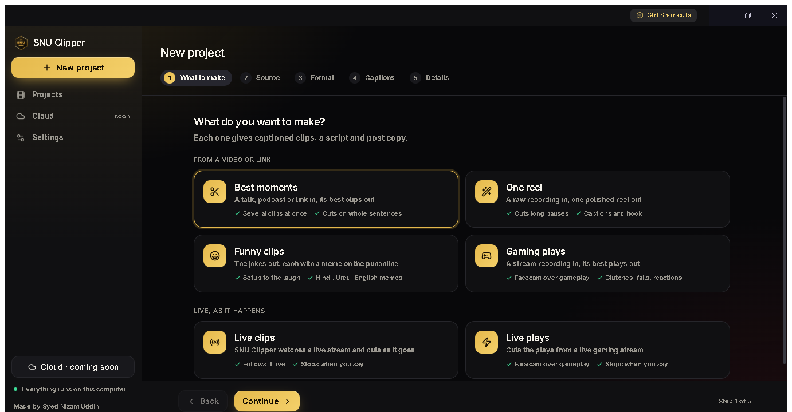
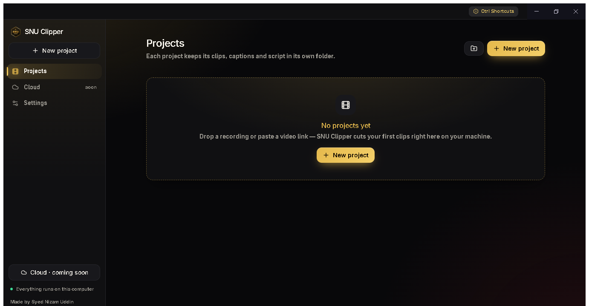
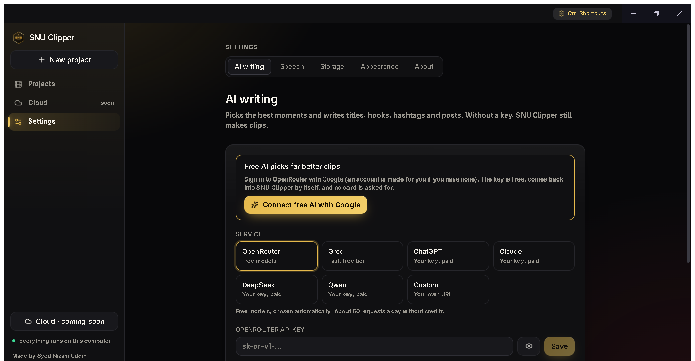
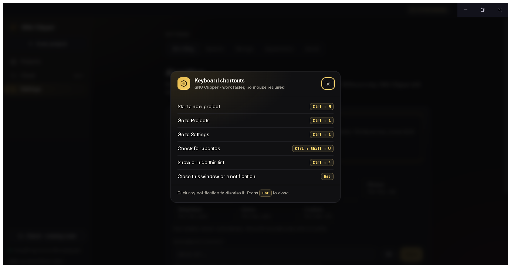

# SNU Clipper (Rebuilt) — v1.19.2

[](https://github.com/nizam1-11/snu-clipper/releases/latest/download/SNU-Clipper-Setup-v1.19.9.exe)

[](https://github.com/nizam1-11/snu-clipper/releases/latest/download/SNU-Clipper-Setup-v1.19.9.exe)
[](https://github.com/nizam1-11/snu-clipper/actions/workflows/verify.yml)
[](https://github.com/nizam1-11/snu-clipper/releases)

**Click the banner or badge above — it downloads `SNU-Clipper-Setup-v1.19.9.exe` directly (no ZIP).** Run it, confirm the prompt, and it extracts the app into a `SNU Clipper` folder and launches it automatically. A portable ZIP is also available on the [Releases page](https://github.com/nizam1-11/snu-clipper/releases) as a fallback.

> यह SNU Clipper v1.19.9 का rebuild hai — neeche setup, commands aur "naya feature kaise add karein" ke steps diye gaye hain.

## Screenshots

Captured from the real app (v1.19.2), dark gold/crimson theme.

| | |
|---|---|
| **New project wizard** — 6 modes, 5 steps | **Projects** — empty state with drag & drop |
|  |  |
| **Settings** — speech, AI, storage, appearance | **Keyboard shortcuts** panel + toasts |
|  |  |

---

## What this is

This is a **rebuilt, editable copy of SNU Clipper v1.19.9**, an app originally made by **Syed Nizam Uddin**. It was produced by static reverse engineering: the installer was unpacked (NSIS / 7z), the Electron `app.asar` archive was extracted, and the main, preload and renderer files were laid out as a readable tree under `out/`.

No original TypeScript source was shipped with the app. What you have is the **compiled-but-readable JavaScript that Electron actually runs** — esbuild output that keeps component names and string literals intact. Treat `out/` as your editable source of truth.

Original tagline: *"Drop a raw video, get social-ready clips with captions, highlights and scripts. Runs 100% on your machine."*

Everything runs locally. The roughly **310 MB** of FFmpeg / FFprobe / ONNX Runtime binaries are intentionally included so transcription, analysis and rendering work fully offline — no account or internet required for the core pipeline.

---

## Folder layout

```
New folder (6)/
├── SNU-Clipper.exe                  # Electron runtime + app bootstrap. Do not edit.
├── package.json                # Clean manifest for the rebuild (no electron dep — exe is bundled).
├── README.md                   # This file.
├── .gitignore                  # Ignores build staging / backups / logs, NOT node_modules or resources.
│
├── out/                        # ★ EDITABLE SOURCE OF TRUTH (readable compiled JS)
│   ├── main/
│   │   ├── index.js            # Electron main process: IPC handlers, settings, downloads, updater, cloud.
│   │   └── engine.js           # Utility/child process: ffmpeg + Whisper + LLM analysis.
│   ├── preload/
│   │   └── index.js            # contextBridge → window.clipie (renderer ↔ main bridge).
│   └── renderer/
│       ├── index.html          # HTML the BrowserWindow loads.
│       └── assets/
│           ├── index-*.js      # React UI bundle (esbuild output, readable).
│           └── index-*.css     # Compiled Tailwind v4 stylesheet.
│
├── resources/
│   ├── app.asar                # Packed app that SNU-Clipper.exe actually loads (rebuilt from out/).
│   ├── app.asar.bak            # Backup of the previous asar, written by `npm run build`.
│   └── app.asar.unpacked/
│       └── node_modules/       # Native binaries that cannot live inside the asar:
│           ├── ffmpeg-static/ffmpeg.exe
│           ├── ffprobe-static/bin/win32/x64/ffprobe.exe
│           └── onnxruntime-node/bin/napi-v6/win32/x64/onnxruntime.dll
│
├── node_modules/               # JS dependencies + the cached @electron/asar packer.
└── tools/
    ├── run.mjs                 # `npm start` → spawns SNU-Clipper.exe.
    ├── rebuild-asar.mjs        # `npm run build` → repacks app.asar from out/.
    └── verify.mjs              # `npm run verify` → integrity checks.
```

---

## Quick start

> **Cloned from GitHub?** This repo is source-only: the 235 MB `SNU-Clipper.exe` runtime and the
> ~200 MB native binaries under `resources/app.asar.unpacked/` are intentionally NOT committed
> (GitHub's 100 MB per-file limit). To make it runnable: copy `SNU-Clipper.exe` into the project root
> and copy `resources/app.asar.unpacked/` from a packaged build (or run `npm install` and rebuild
> the archive with `npm run build`). Secrets (Supabase/Google keys, payment details) were replaced
> with `YOUR-...` placeholders before publishing — fill them in locally if you need cloud/payment
> features.

| Task | Command | Notes |
|------|---------|-------|
| Run the app | `npm start` | Launches `SNU-Clipper.exe` via `tools/run.mjs` with inherited stdio. You can also just **double-click `SNU-Clipper.exe`**. |
| Apply your edits | `npm run build` | Repacks `out/`, `node_modules/` and `package.json` into `resources/app.asar`. Run this after **every** change under `out/`. |
| Check the install | `npm run verify` | Prints PASS/FAIL for the exe, archive, native binaries, entry points and electron-updater, plus total size. |

Important: editing `out/` alone does **not** change the running app — `SNU-Clipper.exe` reads `resources/app.asar`. Run `npm run build` after edits, then restart the app. The previous archive is saved as `resources/app.asar.bak` if you need to roll back.

The build script stages a temporary `build-staging-<pid>/` folder (no leading dot — a dot-prefixed staging path makes `@electron/asar`'s unpack glob match nothing), copies the editable files into it (excluding the `@electron/asar` packer itself), packs it with the locally cached `@electron/asar`, and only then swaps in the new `app.asar` and `app.asar.unpacked`. On any failure it restores the backups and cleans up.

**Unpack rules (important):** the folders `node_modules/@huggingface/transformers/**`, `node_modules/ffmpeg-static/**`, `node_modules/ffprobe-static/**` and `node_modules/onnxruntime-node/**` must stay **outside** the archive — Node/Electron cannot load native binaries from inside an asar. `npm run build` applies the required `--unpack` glob automatically and swaps both `app.asar` and `app.asar.unpacked` (keeping `.bak` copies of each), so this is preserved for you. Manually repacking with `asar pack` **without** `--unpack` embeds those binaries in the archive and breaks FFmpeg, FFprobe and ONNX Runtime.

---

## Keyboard shortcuts & feedback (new)

SNU Clipper now ships with a small productivity layer (append-only, CSS + a self-contained renderer script):

| Shortcut | Action |
|---|---|
| `Ctrl/⌘ + N` | Start a new project |
| `Ctrl/⌘ + 1` | Go to Projects |
| `Ctrl/⌘ + 2` | Go to Settings |
| `Ctrl/⌘ + Shift + U` | Check for updates (result shown as a notification) |
| `Ctrl/⌘ + /` | Show / hide the keyboard-shortcuts panel |
| `Esc` | Close the shortcuts panel or dismiss notifications |

There is also a **Shortcuts** button in the title bar that opens the same panel. Copy actions anywhere in the app show a "Copied to clipboard" toast. Notifications stack up to three, dismiss on click, and auto-hide after a few seconds. The panel and toasts are injected into `document.body` (outside React's `#root`), so React re-renders cannot remove them, and all motion respects `prefers-reduced-motion`.

For future features you can call `window.snuToast("Your message", "success" | "info" | "warn" | "error" | "update")` from the renderer.

---

## Future updates → GitHub (3 commands)

After changing files under `out/` (or anywhere in this folder):

```powershell
cd "C:\Users\Laptop Valley\Downloads\New folder (6)"
npm run build                      # repack resources/app.asar from out/ + node_modules
git add -A
git commit -m "feat: your change here"
git push origin main
```

Check what will be pushed first with `git status --short` and `git diff --stat`.
Anything matched by `.gitignore` (exe, native binaries, `*-backup/` folders) is never pushed.
Verify the live repo any time with `git ls-remote origin refs/heads/main` (should match `git log -1`).

---

## Performance on weak PCs

Clip generation automatically uses a lighter pipeline on machines with **4 or fewer CPU cores**
or **less than 8 GB RAM**:

- FFmpeg uses `-preset ultrafast -crf 22` instead of `veryfast -crf 18`.
- The blurred-background layout uses cheaper blur radii and a single blur pass.
- Audio loudness normalisation (`loudnorm`) is skipped.
- The tiny Whisper model is selected by default, and auto-selection never picks a model
  that is too large for available RAM.
- Each render has a hard 15-minute deadline, so a crawling encode cannot hang forever.

Override with an environment variable when launching the app:

| Variable | Effect |
|---|---|
| `SNU_FAST=1` | Force the lightweight pipeline on any machine. |
| `SNU_FAST=0` | Restore full quality (slower) even on a weak machine. |

Quality is slightly lower in lightweight mode (softer blur, no loudness normalisation,
higher CRF), but clips are produced much faster and more predictably on modest hardware.

---

## Architecture map

- **Electron main process — `out/main/index.js`**
  Owns the app lifecycle and `BrowserWindow`, persists settings/account/folders, manages downloads and cloud sync, wires the auto-updater (`electron-updater`), and registers roughly **65 `ipcMain.handle` channels**. The channels are grouped into namespaces: `settings`, `models`, `ai`, `cloud`, `updates`, `files`, `jobs`, `projects`, `folders`, `memes`, `youtube`, `clipboard`, `app` (channel names follow `namespace:method`, e.g. `settings:get`).

- **Preload bridge — `out/preload/index.js`**
  Uses `contextBridge.exposeInMainWorld('clipie', { ... })` to publish a safe, explicit API to the renderer. Each exposed method maps to `ipcRenderer.invoke('namespace:method', ...args)`. There is no direct Node access from the renderer.

- **Renderer React UI — `out/renderer/`**
  `index.html` loads `assets/index-*.js` (React component tree) and `assets/index-*.css` (Tailwind v4). The bundles are esbuild output, not minified — you can search by component name or visible string.

- **Utility-process engine — `out/main/engine.js`**
  Spawned as a separate child process so long jobs don't block the UI. It drives FFmpeg/FFprobe for media work, Whisper for transcription (via `@huggingface/transformers` + `onnxruntime-node`), and the analysis/LLM step that produces highlights and scripts.

---

## Processing stages

The **UI progress screen** shows seven stages: *Downloading video → Reading video → Extracting audio → Transcribing speech → Finding highlights & writing script → Rendering clips → Finishing up*.

Internally the engine uses six weighted stages (video downloading is handled by the main process before the engine starts):

1. **probe** — inspect the source file with FFprobe (codecs, duration, streams).
2. **audio** — extract/normalize the audio track with FFmpeg.
3. **transcribe** — run Whisper locally to produce a timestamped transcript.
4. **analyze** — derive highlights, captions and scripts from the transcript (LLM/local analysis).
5. **render** — cut and encode the chosen clips, burn in captions.
6. **finalize** — package the outputs and hand them back to the UI / downloads folder.

The job orchestration in `out/main/engine.js` ties these stages together.

---

## Where things are stored

State lives in Electron's `userData` directory (`%APPDATA%\SNU Clipper` on Windows), **not** in the app folder:

```
userData/
├── settings.json      # User preferences
├── account.json       # Signed-in account details (if any)
├── folders.json       # Input/output folder configuration
├── models/            # Downloaded transcription / analysis models
├── cache/             # Working/cache files for jobs
├── bin/yt-dlp         # Bundled/downloaded yt-dlp binary for the youtube namespace
└── memes/             # Meme assets cache
```

Bundled assets worth knowing about: **26 caption fonts**, **5 Inter UI fonts**, `meme library.json` (**143 entries**), and a **YuNet face-detection ONNX** model. The laughter model and meme media are downloaded at runtime rather than shipped.

---

## How to add a feature

Edit files under `out/`, then run `npm run build` and restart the app.

### Walkthrough A — add a new IPC method

1. In `out/main/index.js`, register the handler (pick a namespace + method; the channel is `x:y`):

   ```js
   ipcMain.handle('x:y', async (_event, arg1, arg2) => {
     // your logic here
     return result;
   });
   ```

2. In `out/preload/index.js`, expose it on the `clipie` bridge. If namespace `x` doesn't exist yet, add the object:

   ```js
   x: {
     y: (...a) => ipcRenderer.invoke('x:y', ...a),
   },
   ```

3. In the renderer bundle `out/renderer/assets/index-*.js`, call it:

   ```js
   const result = await window.clipie.x.y(arg1, arg2);
   ```

4. Run `npm run build`, then relaunch. The handler is now inside `resources/app.asar`.

### Walkthrough B — add UI copy / a button

1. Open the readable bundle `out/renderer/assets/index-*.js` (esbuild output — component names and string literals are intact). Find the target component by searching for a visible string such as `Drop a raw video`, then edit the text or JSX.
2. For styling, edit `out/renderer/assets/index-*.css` (compiled Tailwind v4). Add or adjust the relevant class rule.
3. To wire the button from Walkthrough A to your new IPC method:

   ```js
   <button onClick={() => window.clipie.x.y()}>My new action</button>
   ```

4. Run `npm run build`, then relaunch.

---

## Notes, assets and credits

- `out/` is the editable source of truth and contains **readable compiled JavaScript** (not minified). The original TypeScript source was not shipped with the app.
- The ~310 MB of FFmpeg / FFprobe / ONNX Runtime binaries under `resources/app.asar.unpacked/` are included on purpose for full offline functionality — do not delete them.
- Bundled assets: 26 caption fonts, 5 Inter UI fonts, a 143-entry meme library and a YuNet face-detection ONNX model. The laughter model and meme media are fetched at runtime.
- Original app by **Syed Nizam Uddin**, v1.19.1. The original MIT license and Electron/third-party license notices are present in the folder. This rebuild is for studying and extending software you are permitted to modify.
- **Auto-update:** `resources/app-update.yml` points at this repo (`nizam1-11/snu-clipper`, `releaseType: release`) and the fallback in `out/main/chunks/hardware-BuqFOQez.js` matches it. Published GitHub releases are picked up by the updater. If you fork the app, change both places so an update cannot replace your features with someone else's build.
- **Caution:** only add features you have the rights to add. Respect the original licenses and third-party terms, and keep secrets (API keys, tokens, credentials) out of the code and out of `out/`.

---

## Troubleshooting

- `SNU-Clipper.exe was not found` — make sure `SNU-Clipper.exe` sits next to `package.json` in the project root.
- Edits don't show up — you must run `npm run build` after changing `out/`, then fully restart the app.
- `npm run verify` reports FAIL — a required native binary or entry point is missing; restore it from the original package rather than editing the paths in `verify.mjs`.
- Bad build — restore `resources/app.asar.bak` over `resources/app.asar`, fix your edits, and rebuild.
